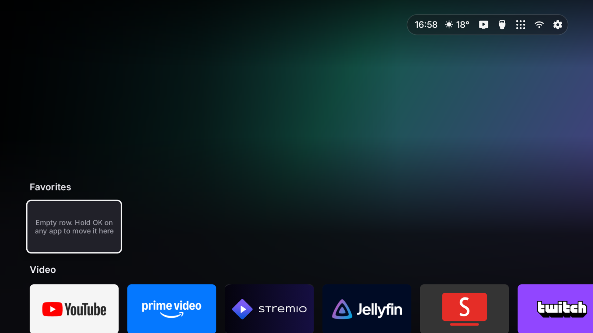
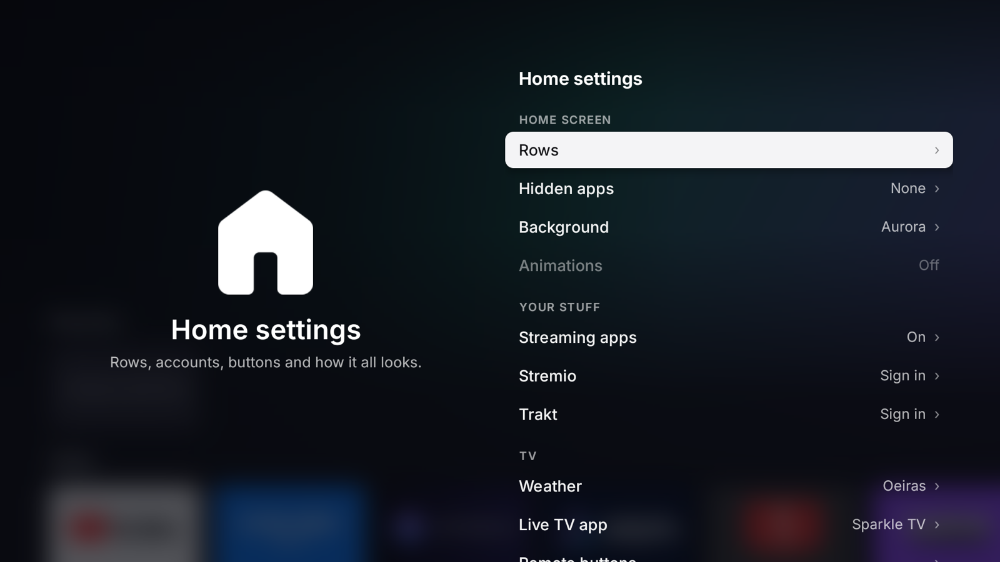

# Debloat TV

**A calm, ad-free home screen for Android TV and Google TV.** Your apps in rows you arrange, what you're watching,
and nothing you didn't ask for.

| | |
|---|---|
|  |  |

- **No ads, no sponsored rows.** Just your apps, your inputs and your titles.
- **What you watch, first.** Stremio's *Continue watching* and *Library*, Trakt's *For you*, *Trending* and *Up next*,
  or *Popular* and *New* on the streaming apps you have (Netflix, Prime Video, Disney+…). Each one only if you use it.
- **Rows you arrange.** Favorites and your own rows. Move a row (it lifts and slides, like apps on an iPhone), hide
  it, rename it; move, copy or hide apps. *All Apps* in a grid.
- **Your remote, your buttons.** Netflix, YouTube, Prime and any spare button can open the app you want, or the
  settings menu.
- **Looks right.** Big artwork of what you select, a glass bar with the time, weather and quick buttons, and a
  background you choose.
- **Safe to try.** Nothing is uninstalled. One command (or one switch on the TV) gives Home back to the TV's own home
  screen.

## Install

You need a computer on the same Wi-Fi as the TV, with [adb](https://developer.android.com/tools/releases/platform-tools)
(macOS: `brew install --cask android-platform-tools`).

**On the TV:** Settings → System → About → press *Android TV OS build* 7 times. Then System → Developer options →
turn on **USB debugging** (and **Wireless debugging** on Google TV).

### The easy way: with Claude Code (or another AI assistant)

```bash
git clone https://github.com/miguelgbandeira/debloat-tv && cd debloat-tv
```

Open [Claude Code](https://claude.com/claude-code) in that folder and say:

> Install Debloat TV on my TV at 192.168.1.50. I live in Lisbon and I use Stremio.

It asks only what it needs, sets everything up and installs it ([CLAUDE.md](CLAUDE.md) tells it how).

### By hand

1. Download `DebloatTV.apk` from the [latest release](../../releases/latest) into this folder (or build it:
   `./build.sh`, needs JDK 17 and the Android SDK).
2. Optional: copy `debloat.conf.example` to `debloat.conf` and fill it in (TMDB key, city, Live TV app…). Anything you
   leave out, the TV asks the first time.
3. Run:

   ```bash
   ./install.sh 192.168.1.50 --config debloat.conf
   ```

   Accept *Allow USB debugging?* on the TV. On Google TV, connect first with the pairing code from Wireless debugging
   (`adb pair IP:PORT CODE`) and pass the address shown there.

**Undo:** `./install.sh 192.168.1.50 --undo`, or on the TV: Settings → Home settings → *Home button opens* → the TV's
own home screen.

## Good to know

- **Keep USB debugging on.** Debloat TV uses it, from the TV itself, for two things: turning remote buttons back on
  after a restart (some TVs, like TCL, switch them off at every start) and the *Home button opens* switch. The TV asks
  *Allow USB debugging?* once. With it off, everything else keeps working.
- **Stremio and Trakt** sign in on the TV with a code you approve on your phone. Trakt also needs your own free Trakt
  app ([trakt.tv/oauth/applications](https://trakt.tv/oauth/applications), redirect URI `http://localhost`).
- **Popular / New on your apps** need a free [TMDB](https://www.themoviedb.org/settings/api) key.
- **Tested on** a TCL Google TV (Android 14). It should work on other Android TV / Google TV sets; tell us how it goes.

## Changing it

It's plain Java with no libraries. `./build.sh` builds `DebloatTV.apk` (JDK 17 + Android SDK: `platforms;android-34`,
`build-tools;34.0.0`); `adb install -r DebloatTV.apk` updates the TV. Icons are regenerated with
`tools/icons.py` (Material Symbols Rounded font) and the app icon/banner with `tools/artwork.py`. Logs:
`adb logcat -s DebloatTV`. Issues and pull requests welcome.

## How it works

A plain Android app (Java, no libraries), built with the SDK's own tools (`build.sh`, no Gradle). The installer
installs it, gives it the permissions it needs and makes it the home screen; on Google TV that means turning off
Google TV's home app (it stays installed, and undo turns it back on). The app talks to the TV's own adb over
`127.0.0.1:5555` for the few system changes it makes after that.

## Credits

- Icons: [Material Symbols](https://fonts.google.com/icons) (Apache 2.0), made into PNGs by `tools/icons.py`.
  Font: [Inter](https://rsms.me/inter/) (SIL Open Font License, `app/assets/fonts/Inter-LICENSE.txt`).
- This product uses the TMDB API but is not endorsed or certified by [TMDB](https://www.themoviedb.org/).
- Weather data by [Open-Meteo.com](https://open-meteo.com/) (CC BY 4.0). Recommendations from [Trakt](https://trakt.tv);
  library from [Stremio](https://www.stremio.com).
- Not affiliated with Google, TCL, Stremio, Trakt or any streaming service. App names and logos belong to their owners.

## License

[MIT](LICENSE)
